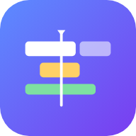

### Montaje — editor de vídeo para el móvil

Editor de vídeo multipista para Android, iPhone/iPad y navegador, inspirado en editores de escritorio como FilmCraft (ArtCraft) o Premiere, pero pensado para usarse con el dedo.

<br clear="left">

## Descargar

| Plataforma | Cómo instalar |
|---|---|
| **Android** | **[⬇ Montaje.apk](https://github.com/frey004/film/releases/latest/download/Montaje.apk)** (o desde [Releases](https://github.com/frey004/film/releases)). Ábrelo y permite «instalar apps desconocidas». Android 7.0 o superior. |
| **iPhone / iPad (app)** | **[⬇ Montaje-unsigned.ipa](https://github.com/frey004/film/releases/latest/download/Montaje-unsigned.ipa)** e instálalo con [AltStore](https://altstore.io) o [Sideloadly](https://sideloadly.io) usando tu Apple ID. Apple no permite instalar apps fuera de la App Store de otra forma. Con un Apple ID gratuito hay que renovarla cada 7 días. |
| **iPhone / iPad (web)** | Abre la versión web en Safari → Compartir → **Añadir a pantalla de inicio**. Funciona sin conexión y no caduca. |
| **Navegador** | La versión web en GitHub Pages: `https://frey004.github.io/film/` (hay que activarla en *Settings → Pages → Source: GitHub Actions*). |

Cada push también deja el APK y el IPA en la pestaña **Actions** como artefactos.

## Funciones

- **Proyectos** guardados en el dispositivo, con formato 9:16, 16:9, 1:1 o 4:5.
- **Línea de tiempo multipista**: pistas de vídeo (V1, V2… las de arriba se superponen), audio (A1…) y texto (T1…). Cursor fijo en el centro: desliza para moverte, pellizca o usa la lupa para el zoom.
- **Editar con el dedo**: toca un clip para seleccionarlo. Arrástralo para moverlo, también a otra pista. Usa las asas blancas para recortarlo. Se ajusta solo a los bordes de otros clips y al cursor.
- **Edición de tres puntos**: en *Medios*, abre un archivo, marca la entrada y la salida, y elige **Insertar** (abre hueco), **Sobrescribir** o **Al final** en la pista que prefieras.
- **Herramientas de clip**:
  - dividir en el cursor;
  - velocidad (0,25x–4x) y volumen (0–200 %);
  - fundidos de entrada y salida;
  - duplicar;
  - eliminar, o eliminar y cerrar el hueco.
- **Ajuste y animación con fotogramas clave**: escala, posición, rotación y opacidad. Toca ◆ para crear un fotograma clave, mueve el cursor y cambia el valor: Montaje interpola entre ellos con suavizado. En la vista previa puedes arrastrar el clip para moverlo y pellizcar para cambiar su tamaño.
- **Color**: brillo, contraste, saturación y sepia, con estilos (Vívido, B/N, Vintage, Cine).
- **Textos** con tamaño, color, contorno y fondo.
- **Pistas**: silenciar, ocultar, subir, bajar y añadir o eliminar pistas.
- **Deshacer y rehacer** (hasta 80 pasos) y guardado automático.
- **Exportar con ajustes por destino**:
  - archivo 1080p o 720p;
  - TikTok, Reels o Shorts (9:16);
  - YouTube (16:9);
  - Instagram (4:5).

  El resultado es un MP4 con sonido que se guarda o se comparte desde el menú del sistema («Guardar vídeo» lo lleva a Fotos en iPhone).

## Cómo funciona

Es una app web (HTML, CSS y JavaScript sin dependencias ni compilación) dentro de [Capacitor](https://capacitorjs.com), que la convierte en app nativa para Android e iOS.

- El audio se decodifica con Web Audio y se programa con precisión de muestra; ese reloj manda.
- Los vídeos siguen a ese reloj y se componen fotograma a fotograma en un `<canvas>`.
- Al exportar, se graban ese canvas y la mezcla de audio con `MediaRecorder`, en MP4 si el dispositivo lo admite. Por eso la exportación tarda lo mismo que dura el vídeo: hay que mantener la app abierta.
- Los proyectos y los archivos importados se guardan en IndexedDB, en el propio dispositivo.

```
www/js/model.js     modelo del proyecto y operaciones (dividir, insertar, sobrescribir, fotogramas clave…)
www/js/engine.js    reproducción, composición en canvas y exportación
www/js/timeline.js  línea de tiempo táctil
www/js/media.js     importación, miniaturas, formas de onda y audio
www/js/app.js       pantallas, herramientas y paneles
```

## Desarrollo

```sh
npm install
npm run serve            # http://localhost:8080 (la versión web)

# Apps nativas (Android Studio / Xcode):
npx cap add android && npx cap sync android && npx cap open android
npx cap add ios && npx cap sync ios && npx cap open ios
```

Las carpetas `android/` e `ios/` no se guardan en el repositorio: GitHub Actions (`.github/workflows/build.yml`) las genera, crea los iconos con `@capacitor/assets` y compila.

### Publicar una versión

1. Sube el número de `version` en `package.json`.
2. Haz push a `main`.
3. Se crea la Release `vX.Y.Z` con `Montaje.apk` y `Montaje-unsigned.ipa`.

### Firma del APK

Para que cada versión se instale encima de la anterior, todas se firman con la misma clave. La clave está cifrada en `signing/release.jks.enc` (una clave propia de Montaje). GitHub Actions la descifra con el secreto **`SIGNING_PASSWORD`** (*Settings → Secrets and variables → Actions*). Sin ese secreto, la Release se publica solo con el archivo de iOS, y el APK queda únicamente en la pestaña **Actions**, firmado con una clave desechable. En cuanto añadas el secreto, el siguiente push sube el APK a la misma Release.

## Limitaciones

- Los códecs que se pueden importar dependen del teléfono. H.264/HEVC en MP4/MOV funcionan en todos; WebM/VP9 no funciona en iPhone antiguos.
- El audio de archivos de más de 450 MB no se carga, para no agotar la memoria.
- Al cambiar la velocidad, también cambia el tono del audio.
- Los ajustes de color necesitan iOS 18 o un Android/Chrome reciente.

## Licencia

GPL-3.0-or-later. Consulta [LICENSE](LICENSE).
